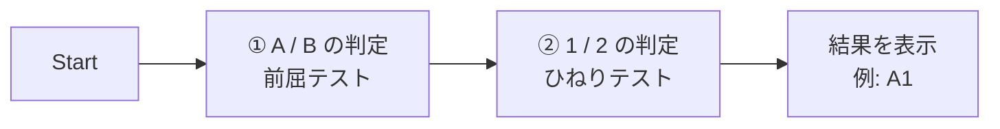

# 4stance Type Checker

Webカメラを使用して、**4スタンス理論**に基づく身体タイプ（A1 / A2 / B1 / B2）を診断するアプリです。
**MediaPipe** による姿勢推定で関節の位置を取得し、簡単な動作テストの結果からタイプを判定します。

**開発期間**：2022年12月

# Motivation

高校時代、トレーナーに4スタンス理論の診断をしてもらったことがあります。
自分のタイプを知ってからは「自分の身体はどう使うべきか」を意識してプレーできるようになり、身体の使い方が大きく変わりました。

そこで、Webカメラさえあれば誰でも簡単に自分のタイプを診断できるアプリを作りました。

# 4スタンス理論とは

人間の身体の使い方には生まれつきのタイプがあり、それを4種類に分類する理論です。

| | A（つま先側） | B（かかと側） |
| :---: | :---: | :---: |
| **1（内側）** | A1 | B1 |
| **2（外側）** | A2 | B2 |

# 診断の流れ

画面の指示に従って動くと、MediaPipe で取得した関節の座標から自動で判定します。
各姿勢を数秒間キープすると、次のステップに進みます。



| | テスト | 動作 | 判定方法 |
| :---: | --- | --- | --- |
| ① | A / B | 膝の**前側**に手を置いて前屈 → 膝の**後ろ側**に手を置いて前屈 | 手首と足首の高さの差を比べ、より深く前屈できた方でタイプを判定 |
| ② | 1 / 2 | 足裏の**内側**に体重をかけて上半身をひねる → **外側**に体重をかけてひねる | 両肩の横幅の変化を比べ、より大きくひねれた方でタイプを判定 |


# Installation


```bash
git clone https://github.com/michiy611/four_stance_classification.git
cd four_stance_classification

pip install -r requirements.txt
```

# Usage

```bash
streamlit run PoseEstimation.py
```

ブラウザが開いたら **Start** を押し、全身がカメラに映る位置に立って、画面の指示に従ってください。

